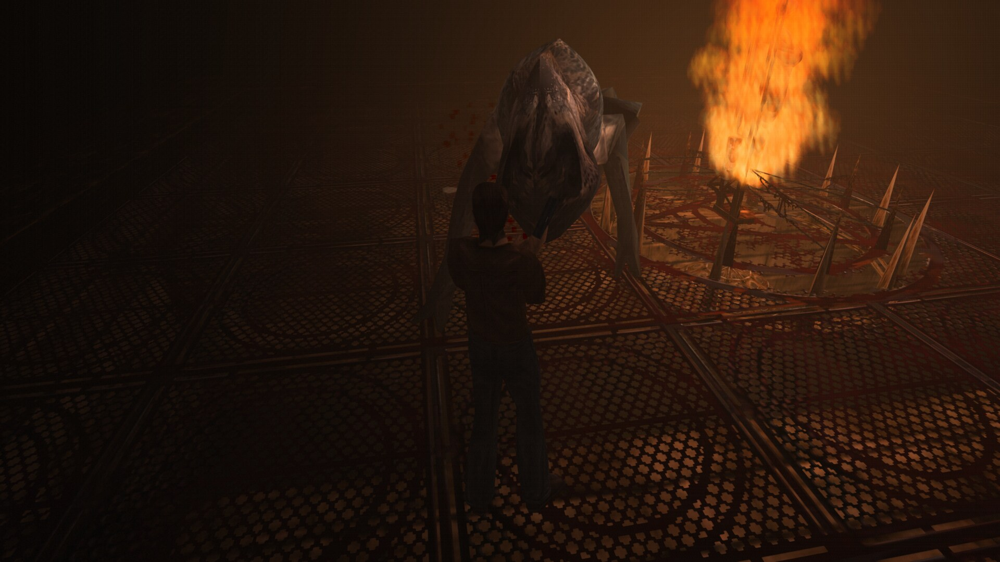
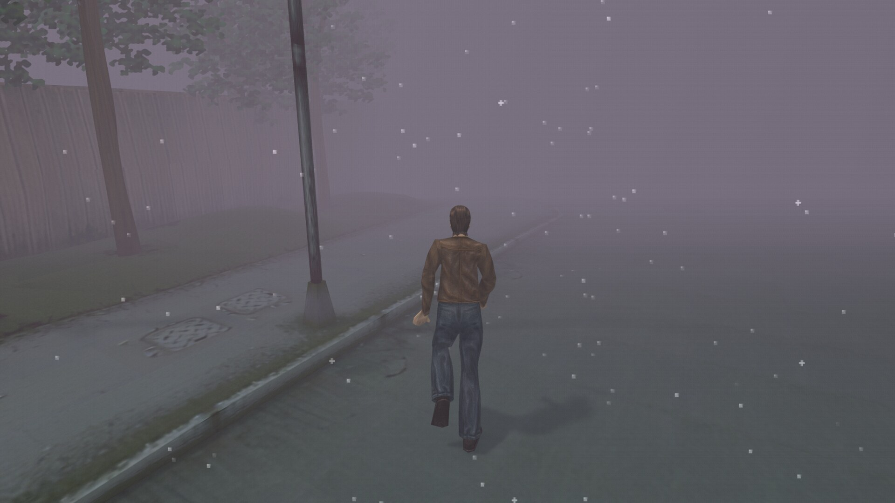
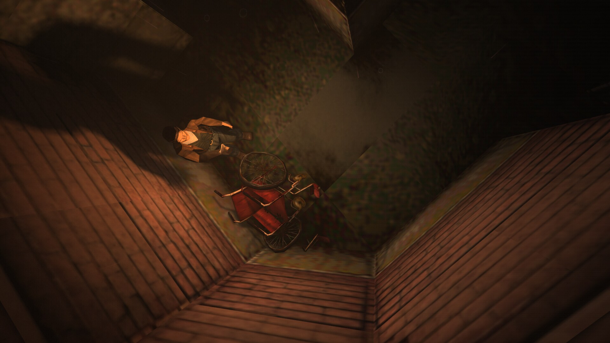
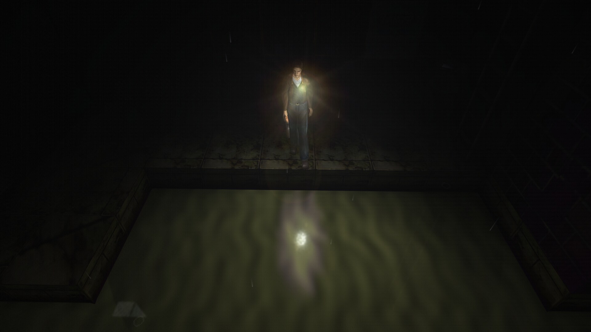

# Silent Hill PC

[](https://github.com/keklick1337/silent-hill-pc/actions/workflows/check.yml)
[](https://github.com/keklick1337/silent-hill-pc/actions/workflows/build-linux.yml)
[](https://github.com/keklick1337/silent-hill-pc/actions/workflows/build-windows.yml)

A from-scratch engine that plays **Silent Hill** (PlayStation, 1999) on Windows and Linux from **your own disc image**.

- **No game files are in this repository or in any release, except the English game text** (and the screenshots below, which show the game's art). On the first start the game reads your disc image (NTSC USA v1.1, `SLUS-007.07`) and converts its models, textures, sound, video and font into a `gamedata/` folder beside the executable. The English messages and item texts are in `gamedata/text/en/` ([COPYRIGHT.md](COPYRIGHT.md), section 3). Without a disc image there is nothing to play.
- **It is not an emulator and not a decompilation build.** The engine holds no code of the original game and no PlayStation emulation. The game's behaviour was written anew, with the community decompilation [silent-hill-decomp](https://github.com/shdecompilations/silent-hill-decomp) read as a description of that behaviour. The rules of Silent Hill itself — maps, events, characters, items, weapons — are data and Lua scripts in [`gamedata/`](gamedata/).
- **Not affiliated with Konami.** Silent Hill is © Konami. This is a personal, non-commercial project; see [COPYRIGHT.md](COPYRIGHT.md).

## Screenshots

Vulkan renderer with ray tracing, 1920x1080, from the author's own disc.

<table>
  <tr>
    <td width="50%"><br>The school boss fight: the fire is a light source, with soft ray-traced shadows on the grate floor.</td>
    <td width="50%"><br>The foggy town by day: the fog and snow are kept, soft sun shadows fall through the fog.</td>
  </tr>
  <tr>
    <td width="50%"><br>The opening alley lit only by Harry's match: warm flickering light and soft shadows.</td>
    <td width="50%"><br>The flashlight reflected in the sewer water (ray-traced reflections).</td>
  </tr>
</table>

## Status

In development. The goal is the original game "about 1:1" — controls, camera, story, enemies, items and puzzles as on the console — with the conveniences listed below; frame-exact console timing is not a goal.

- All 43 maps of the game are data in `gamedata/maps/` and are loaded and stepped by an automated sweep; recorded routes (school, hospital, sewers, the Otherworld, bosses and others) are replayed tick-for-tick as regression tests ([docs/TESTING.md](docs/TESTING.md)).
- Known differences from the original: [below](#differences-from-the-original). Bugs: [issues](https://github.com/keklick1337/silent-hill-pc/issues).
- Linux is the development platform. The Windows build is cross-compiled with mingw-w64 and tested under Wine; reports from real Windows machines are welcome.
- Only the NTSC USA v1.1 disc is supported. PAL and Japanese discs are untested.

## Features

- **Instant loading**: no disc-speed waits (the console's pace can be switched back on in the config).
- **Graphics presets** `original`, `enhanced` (default), `high`, `ultra`, `ultra_rtx`, and `ultra_upscaled`, `ultra_rtx_upscaled` with the experimental model and texture upscaling: resolution scale, anti-aliasing, filtering, shadows, lighting, and on Vulkan HDR, temporal anti-aliasing, volumetric fog, ray tracing and (experimental) model and texture upscaling, with the fog, the darkness and the flashlight kept. Three renderers: OpenGL 3.3, Vulkan and SDL3 GPU ([Renderers](#renderers)). Widescreen, windowed and borderless fullscreen.
- **Keyboard, mouse and controllers** with rebindable actions and on-screen prompts for the device in use.
- **Mods** made of data and sandboxed Lua: replace textures, models, sounds, text and movies; patch any JSON data file; add items, weapons, characters, menus and map events; listen to game events through hooks. Mods stack, have a load order and dependencies, and are switched on and off in *Options > Mods*. No native code is loaded from a mod. See the [modding guide](docs/modding/README.md) and [examples/mods/](examples/mods/).
- **Engine version for mods**: the engine has its own version (the [`VERSION`](VERSION) file, shown by `--version`), and a mod can require one with `min_engine_version`.
- **Built-in modding tools** (F2 when enabled in *Options > Interface*): the game pauses and a free camera flies through the map; viewer switches for fog, light, wireframe and collision; map and room navigation; point picking that copies coordinates as Lua or JSON; map-data overlays and an inspector; a Lua editor; texture and model viewers. See [docs/modding/tools.md](docs/modding/tools.md).
- **Developer console** (`` ` ``) and a categorised log.
- **13 interface languages**: Arabic, Chinese, English, French, German, Italian, Japanese, Korean, Polish, Portuguese, Russian, Spanish, Turkish. The English game text is in `gamedata/text/en/`. Who wrote which translation is in [COPYRIGHT.md](COPYRIGHT.md) (sections 1 and 3); making your own is described in [docs/modding/translation.md](docs/modding/translation.md).
- **Saves** as named files in `.savegames/` beside the executable.
- **Optional gameplay changes** (save anywhere, instant quick save and others) exist only as options marked `GAMEPLAY CHANGE` in the config, each with a note saying which value is the original game; nearly all are off by default.

## System requirements

- A disc image of **Silent Hill, NTSC USA, version 1.1 (`SLUS-007.07`)** that you made from your own disc: `.bin` + `.cue`, a `.bin` alone, or a raw `.iso` — in every case with full 2352-byte sectors. An ordinary 2048-byte `.iso` does not work: it has lost the audio and video streams.
- Windows 10 or 11 (64-bit), or 64-bit Linux with glibc 2.39 or newer (the release is built on Ubuntu 24.04; on an older system, build from source).
- A GPU with OpenGL 3.3, or Vulkan for `renderer = vulkan`. Without a usable GPU driver the game still runs, slowly, rendering on the CPU through Mesa llvmpipe (Linux: the system's Mesa; Windows: the `software_gl/` folder of the package) at the lightest graphics (`software_gl` in `config.cfg`).
- About 2 GB of free disk space for the imported data (and up to 2 GB more for the optional AI texture upscaling cache).

## Download

Get the latest build from the [Releases page](https://github.com/keklick1337/silent-hill-pc/releases):

- Windows: `SilentHillPC-<version>-windows-x86_64.zip`
- Linux: `SilentHillPC-<version>-linux-x86_64.tar.gz`

 A package holds the engine, every library it needs, the base data and the licenses — and no game files.

## First start

1. Unpack it anywhere you can write to.
2. Put your disc image (`.cue` and `.bin`) beside the executable or into a `data/` folder beside it — or pass its path with `--image`.
3. Start `SilentHillPC.exe` (Windows) or `./SilentHillPC` (Linux).

The first start opens a quick setup in a window before anything else: the language, the renderer (OpenGL, close to the original and light enough for any machine, or Vulkan with HDR, volumetric fog, ray tracing and upscaling), a graphics preset and the display, each preselected from the detected graphics card. *Apply* writes them into `config.cfg`; everything else is in the in-game *Options*, where *Run Quick Setup* brings the screen back (so does `--setup`). Then the first start imports the disc image into `gamedata/` and shows a progress window; this takes from half a minute to a few minutes and happens once. After that the disc image is no longer read and the game starts at once. A newer release that needs a new import does it by itself from the same image. When no image is found, the window asks for it: press Browse, type the path or drop the file onto the window, then Import; the path is remembered in `config.cfg` (`import_image`).

Useful options (`SilentHillPC --help` lists all):

| Option | Meaning |
| --- | --- |
| `--image <path>` | the disc image to import |
| `--reimport` | import again, replacing the imported data |
| `--quit-after-import` | import if needed, then exit |
| `--setup` | show the quick setup (language, renderer, graphics, display) before the game |
| `-data <dir>` | use another imported-data folder |
| `-renderer gl\|vulkan\|sdlgpu` | override the renderer of the config for this run ([Renderers](#renderers)) |
| `--version` | print the engine version |

### Linux: menu entry and icon

Nothing is installed by itself. If you want the game in your applications menu, run **one** of

```sh
./SilentHillPC --install-desktop
./install-desktop.sh
```

Either writes `~/.local/share/applications/silent-hill-pc.desktop` (with the absolute path of the executable, so run it again after moving the folder) and the icon sizes into `~/.local/share/icons/hicolor/`. Remove them with `./SilentHillPC --uninstall-desktop` or `./install-desktop.sh --uninstall`. Nothing outside your home directory is touched.

## Controls

Defaults; everything can be rebound in *Options > Controls*. A controller uses the original PlayStation layout.

| Action | Keyboard and mouse |
| --- | --- |
| Move / turn | arrow keys or W A S D |
| Side step | Q, E |
| Run (hold) | Shift |
| Interact, confirm | Space, Enter |
| Ready weapon (hold) / attack | Right mouse button or Z / left mouse button or Left Ctrl |
| Flashlight / reload | F / R |
| Inventory / map | Tab or I / M |
| Look (search view) | V |
| Pause, back | Pause / Esc |
| Quick save / quick load (when enabled) | F6 / F8 |
| Fullscreen | F11 or Alt+Enter |
| Console | `` ` `` |
| Modding tools (when enabled) | F2 |

The controller mapping and the control styles are in *Options > Controls*.

## Configuration

Most settings are in the in-game *Options* screens. All of them, with explanations, are in `config.cfg` beside the executable (the defaults are [assets/config.cfg](assets/config.cfg)): `graphics_preset`, `renderer`, `fullscreen`, `width` / `height`, `vsync`, `fps_cap`, `language`, key bindings, the import options, and the `GAMEPLAY CHANGE` switches. Deleting `config.cfg` and unpacking it again from the package restores the defaults.

### Renderers

The renderer is chosen in *Options > Graphics* (the change applies after a restart) or with `renderer` in `config.cfg`; `-renderer` on the command line overrides it for one run. If Vulkan cannot start, the game falls back to SDL3 GPU and then to OpenGL.

| | OpenGL | SDL3 GPU | Vulkan |
|---|---|---|---|
| What it is | the long-tested path | SDL3's GPU layer (Vulkan, Direct3D 12 or Metal underneath) | the engine's own backend, directly on Vulkan 1.3 |
| Without a GPU | runs on the CPU through Mesa llvmpipe | no | no |
| Base picture (fog, flashlight and its shadows, post-processing) | yes | yes | yes |
| HDR, TAA / TAAU, ambient occlusion, volumetric fog, sun | no | no | yes |
| Ray tracing (shadows, reflections, bounce light; `ultra_rtx`, `ultra_rtx_upscaled`) | no | no | yes, on a GPU with ray queries |
| Model upscaling (experimental) | no | no | yes |
| Texture upscaling (experimental; the upscaler itself needs a Vulkan GPU) | yes | yes | yes |
| Map, fire and gun flash lights | without shadows | without shadows | shadows with ray tracing |

Vulkan is the choice for any current GPU: all the newer graphics need it. OpenGL is for old or weak machines and for running without a GPU. SDL3 GPU is mainly the fallback when the Vulkan backend cannot start.

## Differences from the original

The game follows the original "about 1:1". What differs by default:

- **Frame rate**: 60 fps by default (`fps_cap`); the simulation keeps the original's rules by measuring time in scanlines, and above 60 fps it keeps the 60 Hz step. A slow frame is caught up by several normal steps, so results do not depend on the machine.
- **Loading is instant** (`cd_fast_load`); `cd_speed_ps1 = 1` restores the console's disc pace. All map cells are loaded at once; collision for logic still covers the original's window of cells.
- **Widescreen, resolution, graphics presets, controls and camera styles** are options of the PC version; `original` and the classic control style give the console's picture and controls.

Every change of rules, balance or story is an option marked `GAMEPLAY CHANGE` in `config.cfg`, off by default, with a note saying which value is the original: a pause menu, saving anywhere, instant quick save and load, enemies' bodies that remain, fixes of the original's bugs (the second newspaper, the nurse's grab, slopes), stick and melee changes and others. One is on by default by the project's decision: `aim_resume_after_inventory` (Options > Gameplay).

## Mods

1. Copy the mod's folder into `mods/` beside the executable, so that `mods/<name>/mod.json` exists.
2. Start the game, open *Options > Mods*, switch the mod on (a new mod is off until you do) and let the game restart. The same screen sets the load order. The console does it too: `mods`, `mods enable <id>`.

A mod that changes rules, balance or story is marked `GAMEPLAY CHANGE` on that screen. With an empty `mods/` folder the game is the original.

- The modding guide (English): [docs/modding/](docs/modding/README.md) — getting started, `mod.json`, every kind of data, Lua scripting, the event catalogue, the [Lua API reference](docs/modding/lua-api.md), troubleshooting
- Example mods, each showing one technique: [examples/mods/](examples/mods/README.md). Every release also has them as `SilentHillPC-<version>-example-mods.zip`: unpack it into the game folder, then turn the mods on in *Options > Mods*.
- Data formats written by the import: [docs/FORMATS.md](docs/FORMATS.md), [docs/ARCHITECTURE.md](docs/ARCHITECTURE.md)

[docs/README.md](docs/README.md) lists all documents.

## Modding tools

Switch them on in *Options > Interface > Modding Tools (F2)* (`modding_tools = 1` in `config.cfg`), then press F2 during free gameplay. The game stands still while the editor is open and continues unchanged when you leave it; only explicit actions such as "Place player here" change the game. Outside the game:

- `sh-import` (in the package) — the importer as a command-line tool: `sh-import <image> --out <dir>`.
- [`tools/modding/rig_transfer`](tools/modding/rig_transfer) — fit your own character model to the game's skeleton ([docs/modding/rig-transfer.md](docs/modding/rig-transfer.md)).
- [`tools/translation`](tools/translation) and `tools/scripts/check_translation.py` — build and check a translation ([docs/modding/translation.md](docs/modding/translation.md)).

## Languages

*Options > Language* on the title screen, or `language = <code>` in `config.cfg` (`auto`, the default, is English): `ar de en es fr it ja ko pl pt ru tr zh`. Letters come from the game's own font and the glyph sheets in `gamedata/font/`; a character it lacks is drawn from a bundled or system font. A mod can add a language or replace any line.

## Troubleshooting

- **"No disc image found"** — put the `.cue` and `.bin` beside the executable or in `data/`, or start with `--image <path>`. Check that it is the NTSC USA v1.1 disc and a full-sector image (see *What you need*).
- **The import fails or the game data looks wrong** — start once with `--reimport`.
- **Black window or a crash at start** — try another renderer: `-renderer gl`, `-renderer vulkan` or `-renderer sdlgpu`; update the GPU driver.
- **No sound on Linux** — the bundled OpenAL Soft opens PipeWire, PulseAudio or ALSA at run time; one of them must be running.
- **A mod stopped the game from starting** — move it out of `mods/`. Why a mod was not loaded is shown in *Options > Mods* and by the console command `mods`.
- **Low frame rate or stutter at a place** — open the console (`` ` ``) and type `perfrec start town`, play through the place, then `perfrec stop` (or set `perf_record = 1` in `config.cfg` to record from the start until you quit). Send the three files of `perfrec/` beside the game; `python3 tools/scripts/perf_report.py perfrec/town.csv` shows the hitches and the most expensive graphics passes and places.
- **Reporting a problem** — set `log_file = 1` in `config.cfg`, reproduce it and attach the newest file of `logs/`. The first lines name the engine version and the commit.

## Building from source

Linux builds natively with GCC 14+ or Clang, CMake and Ninja; the Windows build is cross-compiled on Linux with mingw-w64 (a native Windows build is not supported). In short, on Linux:

```sh
cmake -S . -B build -G Ninja -DCMAKE_BUILD_TYPE=Release
cmake --build build
cd build && ./SilentHillPC --image "/path/to/Silent Hill (v1.1).cue"
```

Dependencies, SDL3 from source, the optional FFmpeg and texture upscaler, the Windows cross-build, testing under Wine and packages: **[docs/BUILDING.md](docs/BUILDING.md)**. Running the checks: [docs/DEVELOPMENT.md](docs/DEVELOPMENT.md).

## Project layout

| Path | What |
| --- | --- |
| `src/engine/` | the engine core and the game hosts (`*/game`) |
| `src/render/`, `src/audio/`, `src/input/`, `src/ui/`, `src/media/`, `src/i18n/`, `src/platform/` | subsystems |
| `src/features/` | modding tools, cheats, dumps |
| `src/formats/`, `src/import/` | disc and file formats, the importer and its converters |
| `gamedata/` | the game as data: characters, items, weapons, flags, maps, menus, text, scripts |
| `assets/` | default `config.cfg`, the application icon (`assets/icon/`), the Linux desktop entry, controller database |
| `examples/mods/` | example mods |
| `tests/` | unit tests (`sh_tests`), replay routes, smoke tests |
| `tools/` | importer CLI, replay harness, data checks, dependency and packaging scripts |
| `third_party/` | vendored libraries (Lua, Dear ImGui, miniz, stb, cgltf, bcdec, fonts) |
| `docs/` | the modding guide, the build and development guides, the architecture and the design of every subsystem |

Start with [docs/BUILDING.md](docs/BUILDING.md), [docs/DEVELOPMENT.md](docs/DEVELOPMENT.md) (run, the checks) and [docs/ARCHITECTURE.md](docs/ARCHITECTURE.md); the rules of the project are in [AGENTS.md](AGENTS.md), and [docs/README.md](docs/README.md) lists every document.

## Contributing

Contributions are welcome — code, testing on real Windows machines and other GPUs, translations, mods and documentation. Start with **[CONTRIBUTING.md](CONTRIBUTING.md)**: how to build, how to run the checks, how to pick an issue, and the few rules that keep the project what it is (no game files in the repository, the decompilation is a specification only, the game plays like the original). Bugs and proposals go to the [issues](https://github.com/keklick1337/silent-hill-pc/issues).

## License and credits

The project is free software under the **GNU General Public License, version 3 or later** — see [LICENSE](LICENSE). **[COPYRIGHT.md](COPYRIGHT.md)** is the authoritative statement of which part of the repository is whose and under which terms.

Thanks to:

- the contributors of [silent-hill-decomp](https://github.com/shdecompilations/silent-hill-decomp), whose decompilation made it possible to describe the game's behaviour;
- the authors of the libraries the engine uses: SDL3, OpenAL Soft, FFmpeg, libjpeg-turbo, Lua, Dear ImGui, miniz, stb, cgltf, bcdec, volk, Vulkan Memory Allocator, Vulkan-Headers, ncnn and the Real-ESRGAN model, Mesa llvmpipe; the fonts JetBrains Mono, Oswald, Barlow Semi Condensed and Shinonome; Kenney's input prompts; SDL_GameControllerDB. Their licenses are listed in [COPYRIGHT.md](COPYRIGHT.md), section 2, and their texts are in `licenses/` of every package.

## Legal

This is an unofficial, non-commercial fan project. It is not affiliated with, endorsed or sponsored by Konami. Silent Hill is a trademark of Konami Digital Entertainment; all other trademarks belong to their owners. The project distributes no part of the game other than its English text (see [COPYRIGHT.md](COPYRIGHT.md), sections 3 and 4): to play, you need your own copy of the game.
